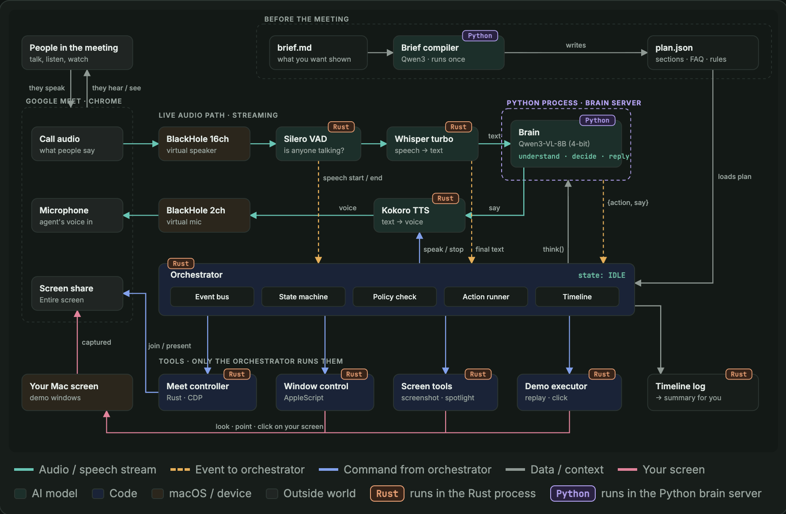

# meet-agent

A local agent that joins Google Meet for you, shares your screen, presents from a
brief and answers questions by voice. Runs on your Mac with open-source models.



Rust runs the orchestrator, audio, speech and every tool; Python runs only the
brain model (Qwen3-VL on MLX). How it all fits together, the meeting flow, states,
models, speed and decisions: [docs/architecture.md](docs/architecture.md).

## Layout

| Path | Language | What |
|---|---|---|
| `crates/agent` | Rust | `meet-agent` CLI: orchestrator, conversation loop, plan, timeline, connectors |
| `crates/audio` | Rust | BlackHole in/out, Silero VAD, Smart Turn |
| `crates/speech` | Rust | Whisper (speech → text), Kokoro (text → speech) |
| `crates/meet` | Rust | Google Meet in real Chrome over CDP |
| `crates/desktop` | Rust + Swift | Window control, keys, screenshots, spotlight ring, clicks |
| `crates/brain-client` | Rust | Starts and talks to the Python brain |
| `brain/` | Python | Brain server: Qwen3-VL on MLX, answers `think()` |
| `protocol/messages.json` | JSON | The Rust ↔ Python message contract |
| `config/` | TOML | Settings and Meet button labels |
| `briefs/` | Markdown | One brief per meeting (`briefs/drafts/` is git-ignored) |
| `prototype/` | Python | Working voice loop from Phase 2, reference for the port |
| `docs/` | Markdown | Architecture doc and diagram |

Models live in `~/.cache/huggingface/hub`. The agent's Chrome profile lives in
`~/meet-agent-chrome`. Neither is in this repo.

## Setup

Needs Rust, `uv`, `just`, Google Chrome and Xcode command line tools.

```bash
brew install blackhole-2ch blackhole-16ch espeak-ng   # then reboot
just models          # all model files (about 20 GB)
just login           # sign in to the agent's Google account once
just doctor          # everything should say ok
```

macOS asks once for each permission, for the app you run `meet-agent` from:

- **Screen Recording** for Google Chrome (sharing) and your terminal (pointing).
- **Accessibility** for your terminal (`do: click/keys/type` demo steps).
- **Microphone** for your terminal (`listen`, rehearsals).

In Audio MIDI Setup, create a Multi-Output Device named **Meet Output** with your
headphones plus BlackHole 16ch, so you and the agent both hear the call.

## Commands

```bash
just rehearse briefs/x.md          # whole meeting locally: present, answer, summary
just run briefs/x.md --now         # join the brief's Meet link and run the meeting
just talk <meet-link>              # join and answer questions; shares when asked
just listen                        # talk to the agent with your mic, no Meet
just brief --from-codex latest     # draft a brief from a planning thread
just point "Orchestrator"          # check what the agent sees on screen
just doctor                        # what is installed, what is missing
just check                         # fmt, clippy, tests
```

While the agent is in a call, type a letter and Enter: `t` take over (your mic) /
hand back, `s` share / stop, `n` next section, `l` leave. Ctrl+C leaves politely.
Every meeting writes `runs/<date>_<name>/` with `plan.json`, `timeline.jsonl` and
`summary.md`.

## Brief format

See [briefs/example.md](briefs/example.md):

```text
---
link: https://meet.google.com/abc-defg-hij
start: 15:00                 (optional; joins one minute early)
share: at_start | on_request | never
---
# Title
## About            free text the agent may talk about
## Sections
### 1. Title
show: app, file or URL to bring forward
point: what to ring on screen
do: open <url> | keys cmd+t | type text | click "Label" | wait 2
- talking point
## FAQ
## Do not discuss
```
