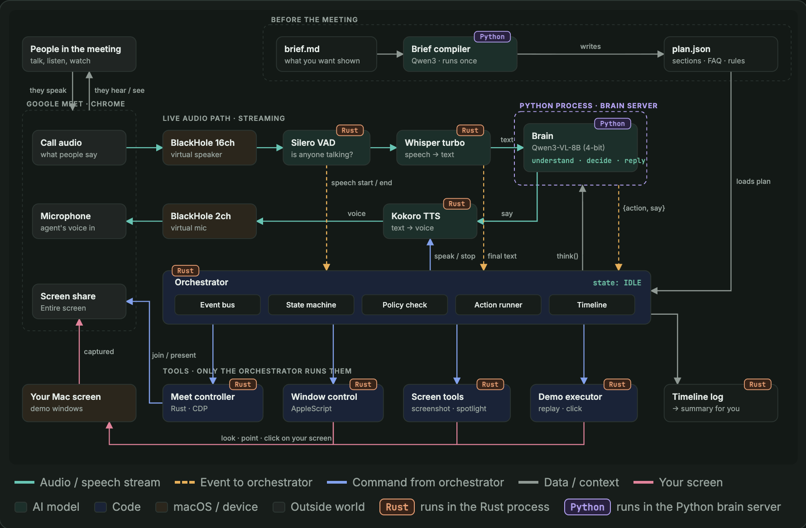

# Architecture

meet-agent joins a Google Meet call for you. It shares your real Mac screen,
presents what you prepared in a brief, and answers questions by voice. Everything
runs locally on a MacBook (M5 Pro, 24 GB) with open-source models.



## Two processes

Rust is the hub. It hears the call, decides what to do, acts and speaks. Python
only runs the brain model, because MLX is the fastest engine for it on Apple
Silicon.

| Process | Runs | Main crates / libraries |
|---|---|---|
| Rust orchestrator (`meet-agent`) | Audio in and out, Silero VAD, Smart Turn, Whisper, Kokoro, state machine, policy check, Meet control, window control, screenshots, spotlight, timeline log | `tokio`, `cpal`, `rubato`, `ort`, `whisper-rs`, `chromiumoxide`, `tokio-tungstenite`, `serde` |
| Python brain server (`brain/`) | Qwen3-VL-8B on MLX. Later: UI-TARS click fallback, Chatterbox voice clone | `mlx-vlm`, `websockets` |

Rust starts the Python server as a child process when a meeting begins, waits for
`ready`, and stops it when the meeting ends. The model loads once (about 20 s) and
stays in memory for the whole call. If Python crashes, Rust restarts it and says a
holding line in the meantime.

Audio never crosses between the processes. They exchange small JSON messages over a
local WebSocket, about 1 ms each. The contract is
[`protocol/messages.json`](../protocol/messages.json); the Rust types are in
[`crates/brain-client/src/protocol.rs`](../crates/brain-client/src/protocol.rs).

| Message | Direction | Purpose |
|---|---|---|
| `ready` | Python → Rust | The model is loaded |
| `think` | Rust → Python | Question + state + allowed actions (+ optional screenshot) |
| `sentence` | Python → Rust | One finished sentence, sent early so speech starts sooner |
| `reply` | Python → Rust | Complete `{action, say}` |
| `cancel` | Rust → Python | Someone interrupted; stop this request |
| `error` | Python → Rust | The request failed; Rust says a safe line |

## Audio routing

BlackHole is a virtual audio cable. Two of them keep the directions apart, so the
agent never hears its own voice.

```
Teammates ──▶ Meet speaker = "Meet Output" ──▶ BlackHole 16ch ──▶ agent hears
                                          └──▶ your headphones ──▶ you hear

agent speaks ──▶ BlackHole 2ch ──▶ Meet microphone ──▶ teammates hear
             └──▶ your headphones ──▶ you hear
```

"Meet Output" is a macOS Multi-Output Device (Audio MIDI Setup) made of your
headphones or speakers plus BlackHole 16ch, with drift correction on BlackHole.
Your real microphone is not in the call while the agent runs, so speakers can't
echo into the meeting.

## How a meeting runs

**Once, at setup**

1. A separate Google account for the agent, invited to meetings like a person.
2. `just login` opens real Chrome with the agent profile (`~/meet-agent-chrome`).
   You sign in by hand once, so Google sees a normal browser.
3. macOS permissions: Screen Recording for Chrome, Microphone, Camera.
4. BlackHole 2ch + 16ch and the "Meet Output" device.

**Before the meeting** (`meet-agent run briefs/<name>.md`)

1. Read config and brief, create `runs/<date>_<name>/`.
2. Start the Python brain server and load the Rust models.
3. Brief → `plan.json` with one `think()` call.
4. Prepare the screen: Do Not Disturb on, demo windows open.

**Joining** (Meet controller, DOM over CDP)

1. Start Chrome with the agent profile and `--remote-debugging-port` on 127.0.0.1.
2. Open the Meet link. In the green room: camera off, microphone = BlackHole 2ch,
   speakers = Meet Output.
3. Click **Join now**, or **Ask to join** and wait up to 5 minutes for the host to
   admit it. Button labels live in [`config/meet-labels.toml`](../config/meet-labels.toml).
4. When the in-call controls appear, state becomes `LISTENING` and the agent says
   hello.

**In the call**

1. Rust reads BlackHole 16ch, VAD detects speech, Smart Turn decides the speaker
   finished.
2. Whisper turns the turn into text.
3. Rust adds state, plan section and rules, then calls `think()`.
4. Python returns `{action, say}`. Rust checks the action is allowed in the current
   state and by the brief.
5. Kokoro speaks into BlackHole 2ch while Rust performs the action (for example
   clicking **Present** over CDP and bringing the demo window forward).
6. If someone talks while the agent speaks, Rust stops the voice immediately.

**Leaving**

Stop presenting, say goodbye, click **Leave call**, write `summary.md` (what was
shown, questions asked, what was deferred to you), stop the Python server.

## States

The orchestrator is always in exactly one state. Each state allows only certain
actions, so the brain can't, for example, stop sharing when nothing is shared.

| State | Allowed actions | Leaves when |
|---|---|---|
| `PREPARING` | open demo files, Do Not Disturb | start time reached |
| `JOINING` | open link, camera off, pick devices, click Join | join clicked |
| `WAITING_TO_BE_ADMITTED` | wait; give up after 5 min and notify you | in-call controls appear |
| `LISTENING` | `speak`, `answer`, `share_screen`, `defer_to_sunny`, `leave` | sharing starts or meeting ends |
| `PRESENTING` | `next_section`, `spotlight`, `run_step`, `stop_sharing` | someone talks (→ `PAUSED`) or plan finished |
| `PAUSED` | `answer`, `defer_to_sunny`, `resume` | question answered |
| `LEAVING` | `stop_sharing`, say goodbye, `leave` | call left |
| `DONE` | write summary | — |

## Models

| Role | Model | Runs in | Status |
|---|---|---|---|
| Brain and eyes | Qwen3-VL-8B-Instruct 4-bit (MLX) | Python, GPU | In use |
| Speech → text | Whisper large-v3-turbo | Rust (`whisper-rs`), GPU | In use (MLX in prototype) |
| Text → speech | Kokoro-82M | Rust (`ort`), CPU | In use (PyTorch in prototype) |
| Someone talking? | Silero VAD | Rust (`ort`), CPU | In use |
| Speaker finished? | Smart Turn v3 | Rust (`ort`), CPU | In use |
| Click fallback | UI-TARS-1.5-7B 4-bit | Python | Phase 5 |
| Smaller brain | Qwen3-VL-4B 4-bit | Python | Backup if 8B is too slow |
| Your own voice | Chatterbox | Python | Later |

Models live in `~/.cache/huggingface/hub` (`just models` downloads them). Whisper
and Kokoro switch to GGML / ONNX files when they move to Rust in Phase 2b.

## Speed and memory

Measured with the prototype, from the end of a question to the first word heard:

| Step | Today | Target |
|---|---|---|
| Smart Turn waits for a pause | ~0.5 s | ~0.5 s |
| Whisper | ~0.3 s | ~0.3 s |
| Brain | ~1.1 s (full answer) | ~0.45 s (first sentence, streamed) |
| Kokoro first audio | ~0.4 s | ~0.25 s |
| Rust ↔ Python hops | ~1 ms each | ~1 ms each |
| **Total** | **2.3–2.8 s** | **~1.5 s** |

Memory on 24 GB: macOS + Chrome + Meet ~8 GB, Rust models ~2 GB, Python brain
~5.5 GB + ~1 GB conversation cache + ~0.4 GB runtime. About 7 GB stays free.

## Decisions

**ADR-001: a code orchestrator coordinates everything.** Not an LLM in the middle
(slower, less predictable, needs a second model) and not models calling each other
(no shared state). One brain call per turn returns both the action and the words.
The orchestrator holds the state, checks every action, and is the only part that
touches Meet or your screen.

**ADR-002: Rust for everything except the brain.** Moving the brain to Rust
(llama.cpp + GGUF) would not make it faster: its speed is set by memory bandwidth,
and MLX is as fast or faster on Apple Silicon. Keeping it in Python costs ~1 ms per
call. Rust gives typed states, instant interruptions, a single binary, and crash
isolation from the model process.

**Meet is driven over CDP, not by a launched automation browser.** Google often
blocks sign-in in browsers launched by automation tools. Starting real Chrome with
its own profile and a debug port, signing in by hand once, and then attaching over
CDP avoids that. The DOM gives every Meet control by its label, in milliseconds,
without vision.

## Build phases

| Phase | What | Done when | Status |
|---|---|---|---|
| 0 | Audio routing: BlackHole + Meet Output | A sound reaches a test Meet; you hear the call | In progress |
| 1 | Rust joins and shares, no AI (`meet` crate, `just login`) | `meet-agent join <link>` joins, shares, leaves | Next |
| 2 | Python voice loop prototype | Answers from a brief by voice | Done (2.3–2.8 s) |
| 2b | Split into Rust + Python brain server | Same answers, ~1.5 s | |
| 3 | Orchestrator, states, brief → plan | "Can you share your screen?" starts sharing | |
| 4 | Screen tools: screenshot → coordinates → spotlight | Points at each section while explaining | |
| 5 | Demo executor + hardening | Full walkthrough with no help | |

## Risks

| Risk | Handling |
|---|---|
| Google asks the agent to sign in again | Detect the sign-in page, stop, ask you to sign in once by hand |
| Meet button labels change | One config file, `config/meet-labels.toml` |
| Popups or tips cover buttons | Close known popups before clicking |
| Nobody admits the agent | Leave after 5 minutes and notify you |
| Sharing the whole screen shows private windows | Do Not Disturb and hide other windows in `PREPARING` |
| Brain returns invalid or disallowed actions | Rejected by the policy check; agent says a safe line |
| Long meetings overflow the brain's context | Keep a running summary instead of the full history |
